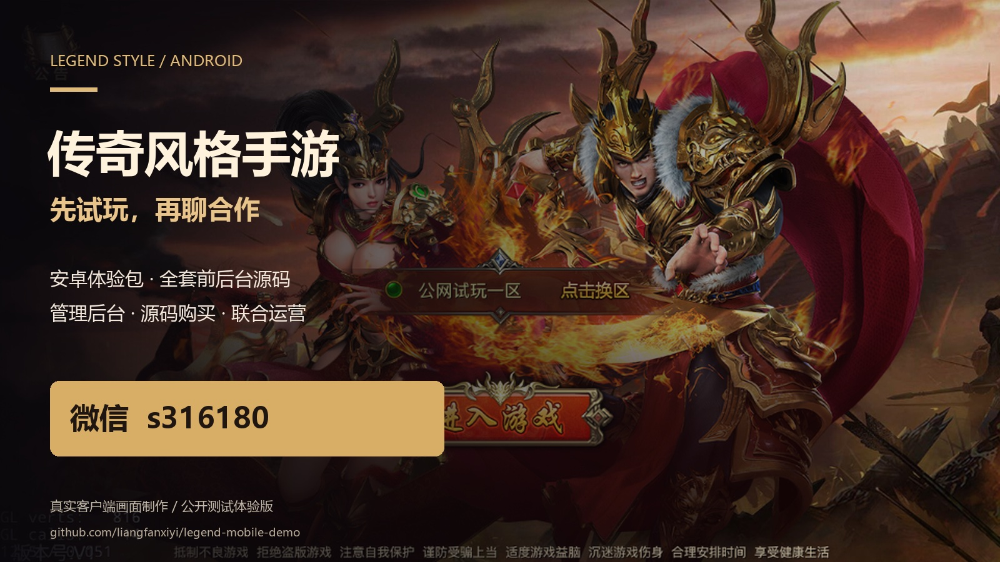
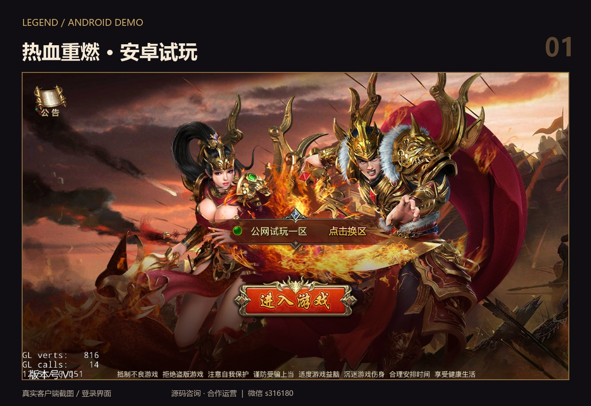
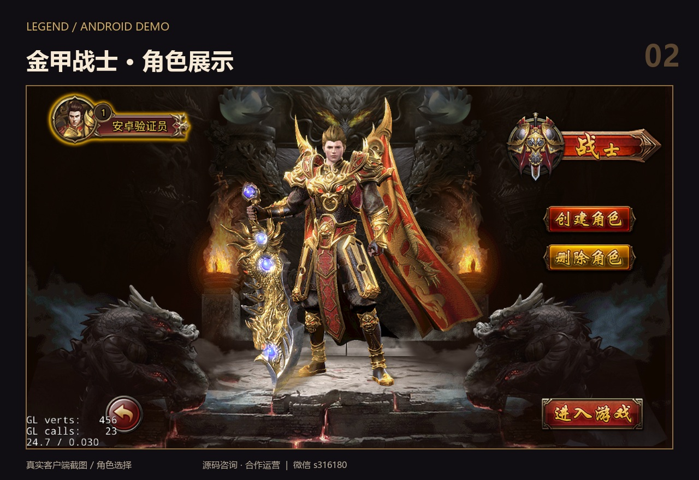
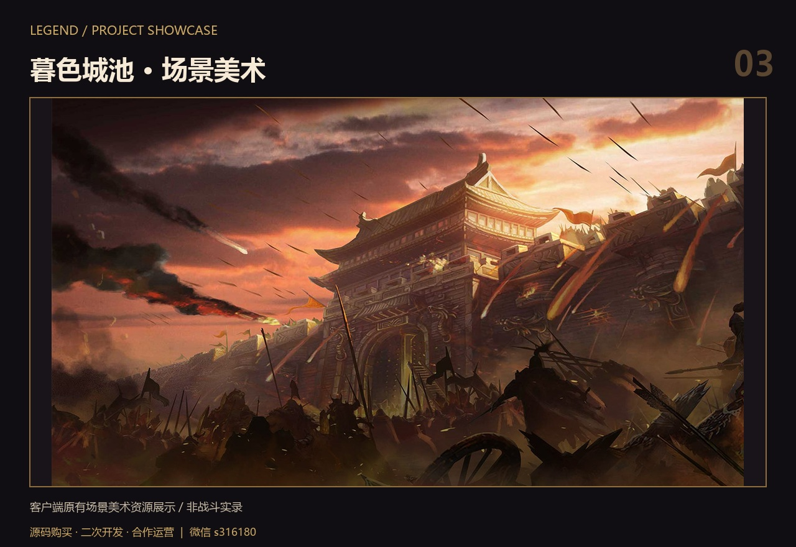
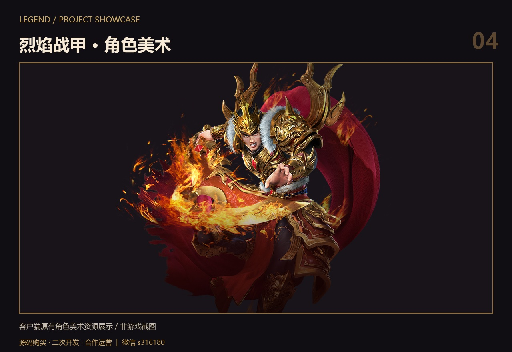
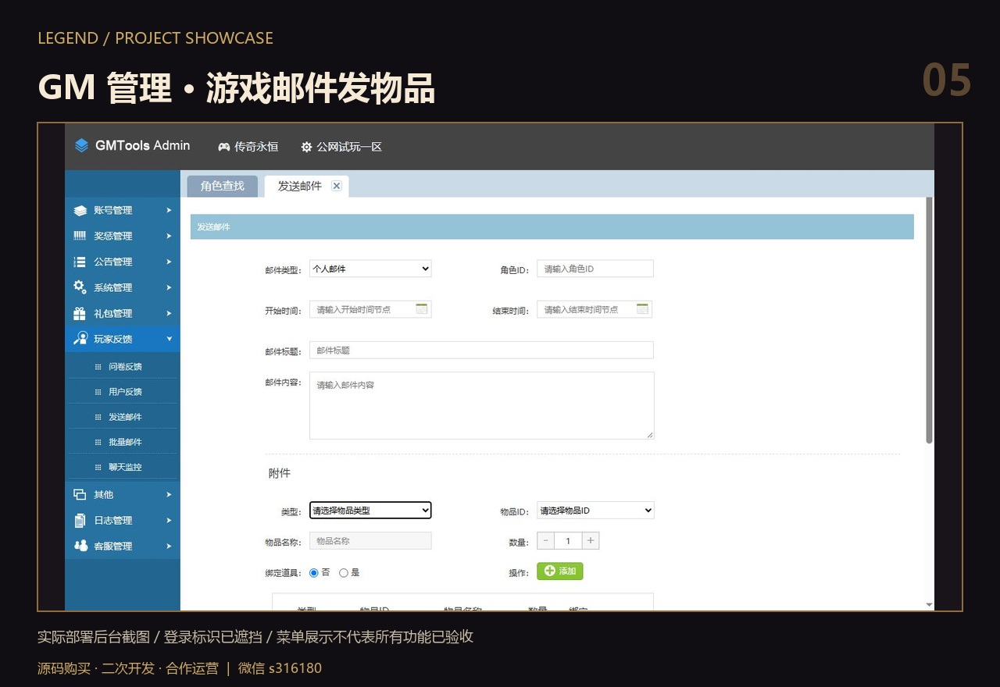

# 传奇风格手游｜安卓试玩 · 源码合作

**先下载体验，觉得合适再聊。** 提供传奇风格网游安卓测试体验包，欢迎玩家试玩，也欢迎有开发、推广或运营资源的伙伴交流。

**源码购买 / 合作运营：微信 `s316180`**（添加时请备注「GitHub 传奇试玩」）

## 下载最新安卓包

### [点击下载最新 APK](https://github.com/liangfanxiyi/legend-mobile-demo/releases/latest/download/legend-mobile-latest.apk)

[查看下载页与版本说明](https://github.com/liangfanxiyi/legend-mobile-demo/releases/latest) · [文件校验](SHA256SUMS.txt)

- 版本：`1.2-public`（build 4），约 **473 MiB**。
- 适用设备：支持 **32 位 ARM 应用**的安卓设备；仅支持 64 位应用的设备无法安装。本版本在 Android 6 ARM 模拟器上完成过安装、登录、选角及进图测试，其他机型兼容性待验证。
- 进入游戏后选择「公网试玩一区」。账号注册或试玩问题，可加微信联系。
- 测试说明：**部分游戏内界面存在白色背景遮挡问题，正在排查**。当前为测试体验版，尚未完成全部机型和玩法验收。
- 此项目仅维护一个最新 APK 下载附件，后续更新继续使用上面的入口。

## 24 秒项目展示短片

https://github.com/user-attachments/assets/2182f40b-a5bb-44c1-a4fe-f4825ce9343d

### [点击观看 / 下载项目展示短片](showcase.mp4)

由下方真实截图与原有美术资源轮播制作，含微信联系方式，**非实机玩法录像**。

## 真实客户端截图

以下为实际运行截图排版，封面由真实登录画面制作。

## 场景与角色美术

以下两张为客户端原有美术资源排版展示，非战斗实录。

## GM 后台展示

已部署的 GM 后台，已验证角色查询与邮件发物品。以下为实际界面，登录标识已遮挡；其他菜单功能不作完整验收承诺。

## 源码购买与合作运营

我这边有整套项目代码，可以沟通**源码购买**，也可以一起探讨**开发、推广和联合运营**。

| 模块 | 项目情况 |
| --- | --- |
| 游戏客户端 | Cocos2d-x / Lua，安卓客户端工程 |
| 游戏服务端 | C++ / Lua，配套数据库与服务配置 |
| 管理后台 | GM 后台，可查询角色、通过游戏邮件发送物品 |
| 前后台项目 | 可交流完整目录、构建方式、部署方式和交付范围 |
| 体验环境 | 已部署公网试玩服务；源码与后台演示可预约沟通 |

**适合交流的伙伴：** 想研究或二次开发传奇风格手游的开发者、有玩家社群和推广渠道的团队，以及希望一起运营项目的伙伴。

**微信：`s316180`**  
可直接说明你的需求：`源码购买` / `二次开发` / `合作运营`。具体报价、交付范围、素材及代码授权范围、支持方式和合作分工，沟通确认后约定。

本仓库用于试玩展示，不公开商业源码；未授予商业运营或素材再分发许可。

## 常见问题

**安装后进不去？** 请先确认手机支持 32 位 ARM 应用、网络可用并选中试玩区；联系微信时附手机型号、安卓版本和问题截图。不要提交账号密码。

**可以看服务端和 GM 后台吗？** 可以联系预约演示，公开页面不提供管理账号或数据库凭据。

**这是正式商业运营版本吗？** 当前提供测试环境体验，具体运营方案、技术完善与授权范围需另行沟通。
